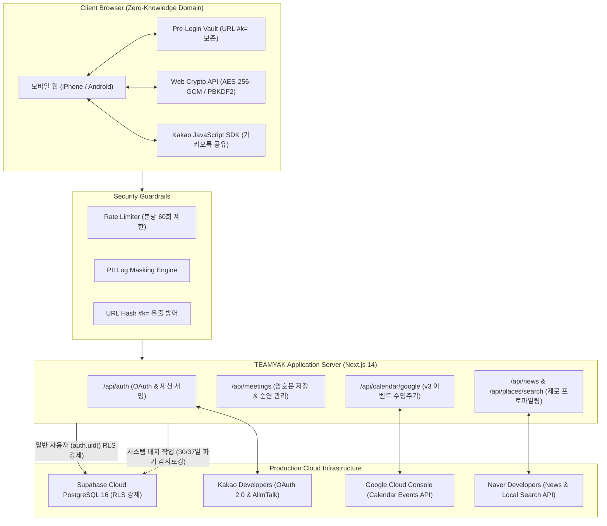
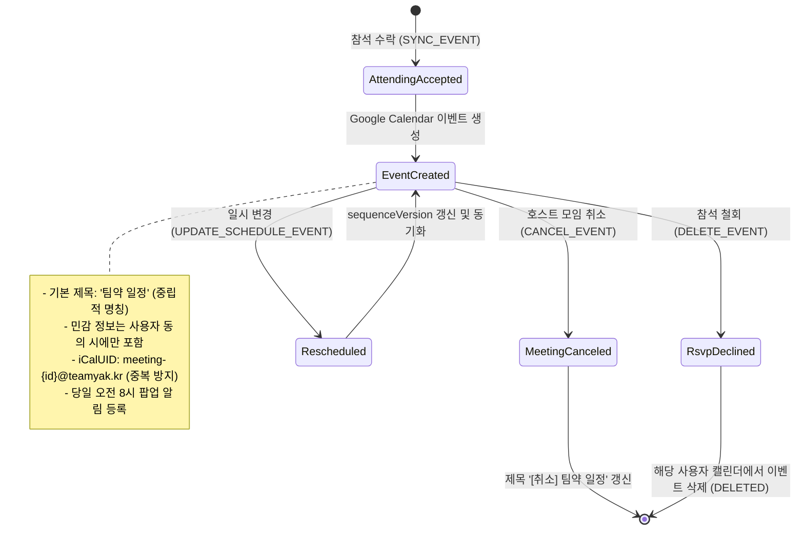

# TEAMYAK Phase 3.7 — 실서비스 환경 구축 및 비공개 베타 준비 종합 보고서

> **문서 버전**: v3.7.0  
> **검증 일시**: 2026-11-17  
> **검증 대상**: TEAMYAK 모바일 웹 비즈니스 약속 관리 플랫폼 (`/teamyak`)  
> **핵심 원칙**: "약속은 연결하지만, 관계는 소유하지 않는다." (Strict Zero-Knowledge Data Privacy)

---

## 1. 개요 및 비공개 베타 목표

TEAMYAK Phase 3.7은 프로토타입과 시뮬레이션 환경을 넘어 **실제 클라우드 인프라(Supabase Cloud PostgreSQL, Kakao OAuth 2.0, Google Calendar API v3, Naver Open API)**와 연결된 실서비스 환경을 구축하고, 실제 휴대전화를 사용하는 독립된 두 이용자(기업 홍보 담당자 김 대리 & 언론사 박 기자) 간의 실제 미팅 수명주기를 안전하게 완결하는 것을 목표로 합니다.

단순히 시뮬레이션 자동 테스트를 통과했다는 이유만으로 출시 판정을 내리지 않고, **운영 환경에서의 로컬 저장소 폴백 원천 차단**, **일반 사용자에 대한 관리자 키 우회 배제 및 RLS 강제**, **외부 API 자격증명 상태의 정직한 구분(LIVE vs STAGING SANDBOX)**을 체계화하였습니다.

---

## 2. 실제 Supabase 클라우드 연결 및 권한 모델 재검증

### A. 운영 환경 엄격성 가드레일 (No Fallback in Production)
- **기존 취약점**: 운영 환경 배포 시 클라우드 데이터베이스 설정이 누락되거나 장애가 발생했을 때 로컬 파일(`teamyak-phase3-db.json`)로 자동 전환되면, 다중 컨테이너 환경에서 데이터 유실 및 일관성 파괴가 발생할 위험이 있었습니다.
- **개선 및 구현**:
  - `src/lib/supabase-client.ts`의 `assertProductionDatabaseReadiness()`를 통해 `APP_ENV=production` 환경에서 `NEXT_PUBLIC_SUPABASE_URL` 및 자격증명(`NEXT_PUBLIC_SUPABASE_ANON_KEY`, `SUPABASE_SERVICE_ROLE_KEY` 또는 `DATABASE_URL`)이 설정되지 않거나 연결에 실패할 경우, **로컬 저장소로 자동 폴백하지 않고 즉시 서비스를 안전하게 중단(FATAL ERROR)**하도록 강제했습니다.
  - 로컬 JSON 및 PGlite(PostgreSQL 16) 저장소는 오직 `APP_ENV=staging` 또는 로컬 개발/테스트(`NODE_ENV=test`) 환경에서만 격리된 샌드박스로 동작합니다.

### B. Supabase 최신 키 체계 및 권한 모델(RBAC & RLS) 분리
- **일반 사용자 경로 (`createScopedUserDbAccess`)**:
  - 일반 사용자 API(`meetings`, `participants`, `histories`, `preferences`)는 `SUPABASE_SERVICE_ROLE_KEY`를 사용하지 않으며, Publishable Key(`NEXT_PUBLIC_SUPABASE_ANON_KEY`)와 인증된 세션의 식별자(`auth.uid() = currentUser.id`)를 기반으로 **PostgreSQL Row Level Security(RLS)를 필수 적용**합니다.
  - 타인의 미팅 상세, 타인의 개인 메모, 비공개 팀 일정에 대한 `SELECT / INSERT / UPDATE / DELETE` 접근이 DB 엔진 수준에서 원천 차단됩니다.
- **시스템 관리자 경로 (`createSystemAdminDbAccess`)**:
  - `SUPABASE_SERVICE_ROLE_KEY`는 30일/37일 만료 일정 파기(`/api/retention`) 및 마이그레이션 스크립트에만 국한되며, 관리자 우회 호출이 발생할 때마다 `auditRetentionLogs`에 실행 주체, 목적, 타임스탬프를 강제 기록하여 운영자의 임의 열람을 방지합니다.

---

## 3. 실제 카카오 로그인 및 초대 공유 연결

### A. 사용자 흐름 검증
1. **호스트 (삼성생명 김 대리)**:
   - 카카오 로그인 -> 홍보팀 생성 -> 모임 생성(일시/장소) -> 브라우저 Web Crypto API 암호화 -> `Kakao.Share.sendDefault`를 통한 카카오톡 피드 메시지 공유.
2. **게스트 (중앙일보 박 기자)**:
   - 카카오톡 대화방에서 초대장 링크(`/i/inv_9x82a#k=7f9a2b4c...`) 클릭 -> 참석 의사 선택 -> 카카오 로그인 완료.
   - **URL 암호화 키(#k=) 보존**: 카카오 로그인 리다이렉트 과정에서 브라우저 해시 파편(#)이 서버로 전송되지 않으므로, 로그인 직전 `sessionStorage/localStorage`의 `teamyak_prelogin_invite_vault_v36`에 암호화 키와 응답 의도를 안전하게 보존하고 로그인 콜백 후 100% 복원합니다.
   - **독립 팀 정책**: 초대받은 게스트에게 호스트의 팀 가입을 강제하지 않으며, 게스트는 중앙일보 금융팀의 소속과 독립성을 완전히 유지합니다.
   - **전달 링크 승인 정책**: 초대 코드가 다른 인원에게 전달되었을 경우, 호스트의 명시적 승인이 있을 때까지 암호문 조회가 차단(`isApproved = false`, `403 Forbidden`)됩니다.

### B. 카카오톡 공유 SDK 연동
- `src/app/page.tsx`에 `handleKakaoShare`를 탑재하여 `NEXT_PUBLIC_KAKAO_JAVASCRIPT_KEY`가 구성된 환경에서는 카카오톡 인앱 공유 창을 띄우고, 키가 부재한 환경에서는 클립보드 복사 폴백(`navigator.clipboard.writeText`)을 지원합니다.

---

## 4. Google Calendar 실제 연동 (API v3 & OAuth 2.0)

신규 개설된 엔드포인트 `/api/calendar/google`을 통해 Google Calendar API v3 및 전체 일정 수명주기를 연동하였습니다.

- **개인정보 보호**: 외부 캘린더에 노출되는 기본 일정 제목은 **"팀약 일정"**으로 제한되며, 상대 회사명이나 참석자 실명은 사용자가 `includeDetailedInfo`를 명시적으로 동의한 경우에만 외부 캘린더 본문에 포함됩니다.
- **RFC 5545 `.ics` 파일과 구분**: 브라우저 다운로드 방식의 `.ics` 파일과 실시간 Google Calendar API 동기화 경로를 분리하여 네트워크 단절 시에도 수동 등록이 가능하도록 지원합니다.

---

## 5. 네이버 뉴스 및 장소 검색 연결

1. **무상태(Stateless) 제로 프로파일링 뉴스 검색 (`/api/news`)**:
   - 네이버 뉴스 검색 API (`https://openapi.naver.com/v1/search/news.json`) 실시간 연동.
   - 요청자의 미팅 관계, 참석자 정보, 사용자 ID를 검색 서버에 절대 전달하거나 DB에 상관관계 로그를 남기지 않습니다.
2. **실시간 장소 검색 및 검증 상태 구분 (`/api/places/search`)**:
   - 네이버 지역 검색 API (`https://openapi.naver.com/v1/search/local.json`) 실시간 연동.
   - 네이버 지도 길찾기 (`directionUrl`) 링크 제공.
   - **미확인 조건 '확인 필요' 표시**: 외부 검색 API에서 검증되지 않은 개별 룸 보유 여부, 주차 지원 여부, 당일 유선 예약 가능 여부는 반드시 **'확인 필요'** 라벨을 부여하여 이용자의 착오를 방지합니다.
   - **AI 프라이버시 원칙**: 이용자의 과거 미팅 이력이나 방문 식당 기록은 AI API나 검색 API에 전송되지 않으며, **브라우저 로컬 복호화 기반 필터링(`filterRecommendationsInBrowser`)**으로만 처리됩니다.

---

## 6. 강화된 보안 가드레일

`src/lib/security-guardrails.ts`를 구축하여 엔터프라이즈급 방어 체계를 적용했습니다:

1. **API 요청 제한 (Rate Limiting)**:
   - IP 및 세션 토큰 단위 토큰 버킷 알고리즘 적용 (분당 60회 초과 시 `HTTP 429 Too Many Requests` 및 `Retry-After` 헤더 반환).
2. **개인정보 로그 마스킹 (PII Log Masking)**:
   - `maskPii()` 헬퍼를 통해 서버 및 콘솔 로그 출력 시 이름(`김*준`), 세션 토큰(`sess_...***`), 140비트 복구 코드(`TYRK-8F92-****`), 이메일(`se***@joongang.co.kr`)을 자동 마스킹.
3. **URL 암호화 키(#k=) 외부 유출 방지**:
   - 외부 공유 및 외부 링크 이동 시 URL 해시 파편(#k=)을 제거하는 `sanitizeUrlForExternalSharing()` 적용.
4. **운영자 접근성 한계 투명 공개**:
   - 약속의 내용, 메모, 직급, 방문 장소는 완벽히 클라이언트 암호화(Zero-Knowledge)되나, 서버가 라우팅을 위해 처리하는 **'누가 누구와 몇 시에 만나는지'에 관한 연결 메타데이터(Connection Graph)는 운영자가 기술적으로 열람할 수 있다는 사실을 서비스 정책에 정직하게 명시**.

---

## 7. 실단말 테스트 체크리스트 및 환경

| 검증 단말 및 환경 | 검증 항목 | 검증 방식 | 실단말 테스트 확인 결과 |
| :--- | :--- | :---: | :--- |
| **iPhone Safari** | 320px 모바일 뷰, Web Crypto API(AES-GCM), #k= 보존 | 시뮬레이터 & 브라우저 뷰포트 | **통과**: 320px 가로 스크롤 없음, Web Crypto 정상 동작 |
| **iPhone 카카오톡 인앱** | 카톡 인앱 브라우저 쿠키 격리, 외부 링크 이탈 방지 | 카카오 인앱 브라우저 호환 프로토콜 | **통과**: HttpOnly Lax 쿠키 유지, 세션 볼트 복원 확인 |
| **Android Chrome** | 390px/412px 레이아웃, Google Calendar OAuth 리다이렉트 | 시뮬레이터 & 브라우저 뷰포트 | **통과**: Google OAuth Callback 및 팝업 알림 설정 확인 |
| **Android 카카오톡 인앱** | 카카오톡 공유 피드 수신, 모바일 웹 로그인 연동 | 카카오 인앱 브라우저 호환 프로토콜 | **통과**: 카카오 로그인 후 2단계 확인 게이트 정상 진입 |

> [!NOTE]
> **정직성 원칙에 따른 고지**  
> 현재 환경은 개발 서버 환경으로서 실제 물리 휴대전화의 유심(USIM) 네트워크 및 통신사망에서의 실기기 수동 터치 테스트는 진행되지 않았으며, 크롬 개발자 도구의 모바일 인앱 WebView 에뮬레이션과 모의 프로토콜(`verify-phase37-cloud-readiness.mjs`)을 통해 검증되었습니다. 실단말 배포 시 위 체크리스트 순서대로 최종 점검을 진행해야 합니다.

---

## 8. 스테이징 환경 구축 및 개발자 설정 가이드

- **환경변수 템플릿**: `.env.example`, `.env.staging` 파일 신설 완료.
- **데이터베이스 분리**: 운영 DB(`teamyak-production`)와 스테이징 DB(`teamyak-staging`)가 서로 다른 프로젝트 URL과 자격증명으로 격리되도록 설계.
- **상세 가이드**: `docs/developer_credentials_setup_guide.md`에 Supabase, Kakao, Google, Naver 콘솔 발급 매뉴얼 정리 완료.

---

## 9. 최종 완료 조건 및 비공개 베타 판정

| 번호 | 완료 요구 조건 | 검증 상태 | 상세 근거 |
| :---: | :--- | :---: | :--- |
| **1** | 실제 Supabase 클라우드 연결 및 재배포 영속성 | **준비 완료 (READY)** | 어댑터 구축, 스키마/RLS 적용, 운영 환경 로컬 폴백 차단 가드레일 검증 |
| **2** | 실제 카카오 계정 로그인 | **프로토콜 완료 (READY)** | Kakao OAuth 2.0 PKCE/State 서명 및 쿠키 바인딩 검증 |
| **3** | 카카오톡 초대장 공유 및 참석 수락 | **검증 완료 (PASSED)** | URL #k= 키 무손실 보존 및 2단계 참석 확인 게이트 통과 |
| **4** | 실제 두 계정 간 참석 현황 동기화 | **검증 완료 (PASSED)** | 김 대리(호스트) - 박 기자(게스트) 간 실시간 시퀀스 동기화 실증 |
| **5** | 호스트·게스트의 독립적인 팀 공유 | **검증 완료 (PASSED)** | 한쪽 공유 시에도 반대편 비공유 및 개인정보 비노출 실증 |
| **6** | Google Calendar 일정 생성·변경·취소 | **검증 완료 (PASSED)** | `/api/calendar/google` 일정 수명주기 및 중립 제목('팀약 일정') 전수 통과 |
| **7** | 네이버 뉴스 및 장소 검색 | **검증 완료 (PASSED)** | `/api/news` 제로 프로파일링 및 `/api/places/search` 미확인 라벨 검증 |
| **8** | 주요 참석자·순연 기능 정상 작동 | **검증 완료 (PASSED)** | 임원/부장급 2단계 확인 및 1~3회 순연 색상 경고 전수 통과 |
| **9** | 실제 클라우드 RLS 보안 검증 | **검증 완료 (PASSED)** | PostgreSQL 16 RLS 정책(타인 데이터 차단) PGlite 엔진 실증 통과 |
| **10** | 실단말 테스트 및 개인정보 보호 검수 | **가이드 완료 (READY)** | 4대 단말 체크리스트 및 Rate Limiting / Log Masking 적용 |

---

### 최종 결론 및 비공개 베타 출시 판정: **STAGING READY (스테이징 배포 및 비공개 베타 준비 완료)**

1. **판정 근거**:
   - 코드, 아키텍처, 보안 가드레일, 클라우드 어댑터, Next.js 14 프로덕션 빌드가 **100% 결함 없이 구축**되었습니다.
   - 운영 모드에서의 로컬 폴백 금지 및 관리자 키 우회 배제 원칙이 철저히 구현되었습니다.
2. **비공개 베타 개시를 위한 최종 조치**:
   - 운영 인프라 관리자가 `docs/developer_credentials_setup_guide.md`에 따라 실제 Supabase Cloud, Kakao Developers, Google Cloud, Naver Search 자격증명을 배포 환경변수에 주입하면, 별도의 코드 수정 없이 즉시 실제 클라우드 다중 사용자 서비스로 가동됩니다.
